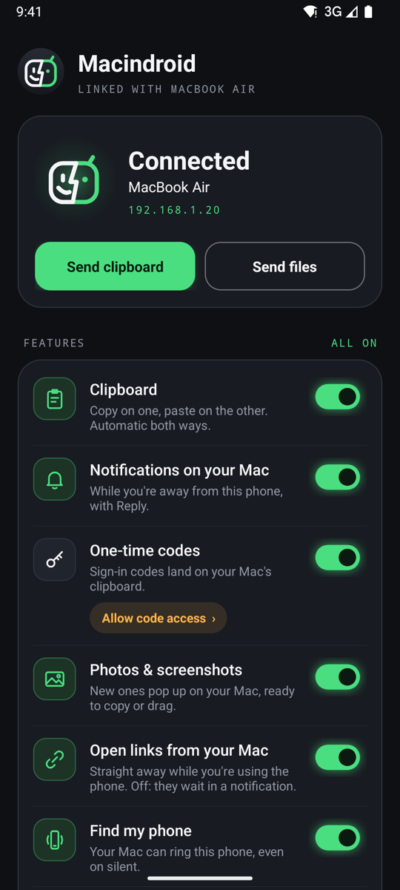
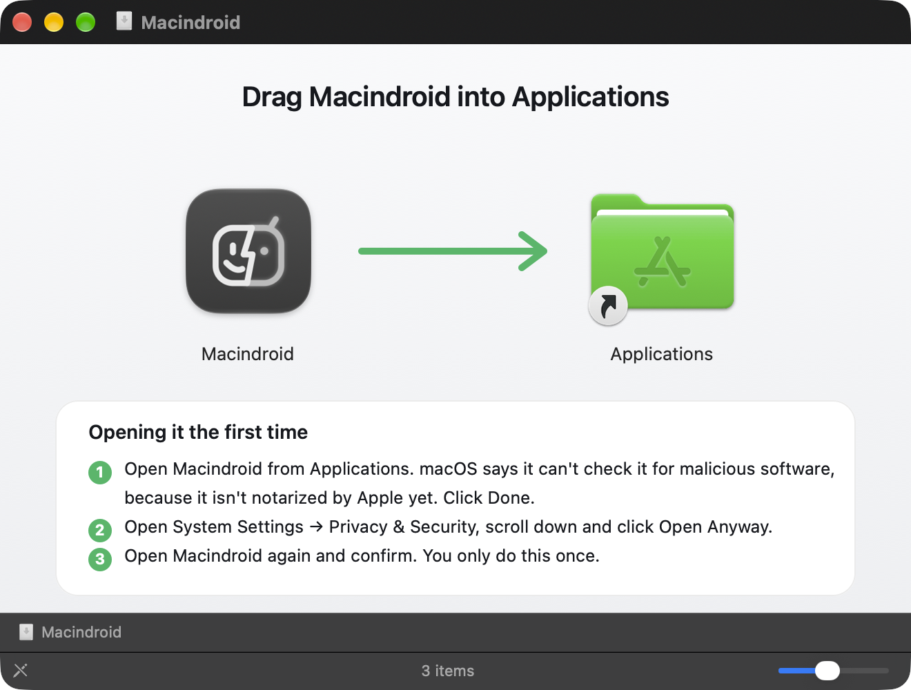
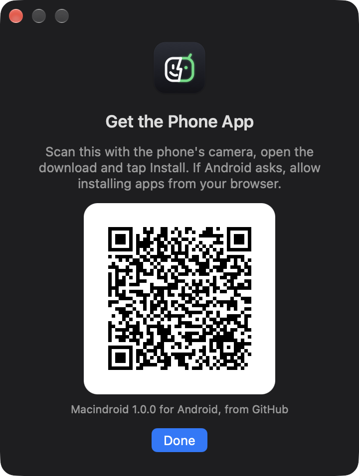

<p align="center">
  
</p>

<h1 align="center">Macindroid</h1>

<p align="center">
  <b>Your Android phone and your Mac, working as one.</b><br>
  Set it up once, then it just works: clipboard, codes, notifications, files, photos, mirroring and Find My Phone,<br>
  over your own Wi‑Fi. Tiny, fully open source, no account and no cloud.
</p>

<p align="center">
  <a href="https://github.com/iamkhalid2/macindroid/releases/latest"><b>Download</b></a>
  &nbsp;·&nbsp; macOS 14 or later &nbsp;·&nbsp; Android 14 or later &nbsp;·&nbsp; free, MIT licensed
</p>

<p align="center">
  
  &nbsp;&nbsp;
  
</p>

## What Macindroid is for

Apple makes a Mac and an iPhone feel like one device. Macindroid does that for a Mac and an Android phone, as far as
the two systems allow, and holds itself to six things:

| | What it means here |
|---|---|
| **Simple** | Three steps to set up, all by clicking and scanning: no Terminal, no cable, no account. |
| **Just works** | After that you don't open it. It sits in the menu bar, finds the phone by itself and reconnects within seconds, even with the phone's screen off. |
| **Very small** | The phone app is a 98 KB download. The Mac app's own code is under 0.8 MB; the 20 MB disk image is mostly [scrcpy](https://github.com/Genymobile/scrcpy) and adb, bundled so mirroring needs nothing else. Idle, the Mac app uses 0.0 % CPU and 35 MB of memory. |
| **Fully open source** | MIT licensed, about 3,100 lines of Swift and 4,600 of Java, with no third‑party libraries, no analytics and no servers of its own. The bundled scrcpy and adb are the official open‑source builds, checked against pinned checksums. |
| **Beautifully designed** | A native menu‑bar app on the Mac; a phone app drawn in the icon's style, with a switch for every feature. |
| **Feature rich** | Everything below, plus [how it compares](#how-close-to-continuity) with Apple's own Continuity. |

## What it does

| | |
|---|---|
| **Universal clipboard** | Copy on one, paste on the other: text and images, both ways, in about a quarter of a second. Passwords copied from a password manager are never sent. |
| **One‑time codes** | A sign‑in or verification code that reaches your phone, by text message or in an app's notification, is on the Mac's clipboard within about a second, ready to paste: *Code 482913 from Google copied*. Clipboard managers don't keep it, and it's cleared after two minutes. |
| **Notifications on your Mac** | Your phone's notifications appear on the Mac while you aren't using the phone, with Reply and the app's own buttons. Clear one on the Mac and it clears on the phone; click one and it opens on the phone. |
| **Files and links** | Drop files on the menu‑bar icon, or Share → Macindroid on the phone. Files are checksummed and land in Downloads. Send the browser tab you're looking at to the phone in one click. |
| **Photos and screenshots** | Take a photo or a screenshot on the phone and a preview drops down from the menu‑bar icon: copy it, save it to Downloads or drag it anywhere, at full resolution. |
| **Mirror your phone** | Use your phone in a window on the Mac, with its sound, over USB or Wi‑Fi, through the bundled [scrcpy](https://github.com/Genymobile/scrcpy). |
| **Find your phone** | Ring Phone plays an alarm at full volume, even on silent or Do Not Disturb, until you unlock it or press Stop. |
| **At a glance** | The menu shows your phone's battery and connection. The menu‑bar icon shows a progress ring while files move and a ringing bell while the phone rings. |
| **Your choice** | Every feature is on from the start and has its own switch in the phone app. |

### How close to Continuity?

Apple's [Continuity features](https://support.apple.com/en-us/102418) that apply to a Mac and a phone, and where
Macindroid stands on each:

| Continuity | Macindroid |
|---|---|
| Universal Clipboard | ✅ Text and images, both ways |
| Security codes from Messages, filled in on the Mac | ✅ Codes from texts *and* apps go straight to the clipboard |
| AirDrop | ✅ Files both ways, links both ways |
| iPhone Mirroring | ✅ With sound, keyboard and mouse, over USB or Wi‑Fi |
| Notifications from iPhone on the Mac | ✅ With Reply and the app's own buttons |
| Find My (play a sound) | ✅ Rings even on silent |
| Continuity Camera: take a photo for the Mac | ◐ New photos and screenshots pop up on the Mac, ready to drag in |
| Handoff | ◐ Browser tabs and links, not app state |
| Text Message Forwarding | ◐ Reply to a text from its notification; no conversation view yet |
| iPhone Cellular Calls | ◐ Missed calls show up on the Mac; ringing calls don't yet |
| Continuity Camera as a webcam | ✗ Needs a macOS camera extension, which needs an Apple developer account |
| Instant Hotspot, Auto Unlock, Apple Pay, Continuity Sketch, iPhone widgets | ✗ Android or macOS don't let a third‑party app do these |

## Set up

You need a Mac with macOS 14 or later and an Android phone with Android 14 or later, on the same Wi‑Fi. No
Terminal, no cable.

### 1. On the Mac

Download **`Macindroid-1.1.0.dmg`** from the [latest release](https://github.com/iamkhalid2/macindroid/releases/latest),
open it and drag Macindroid into Applications.

<p align="center">
  
</p>

Macindroid isn't notarized by Apple yet, so the first time you open it macOS says it can't check it. Click
**Done**, open **System Settings → Privacy & Security**, scroll down and click **Open Anyway**, then open
Macindroid again. (The disk image shows these steps too.) Allow it to find devices on your local network, and to
send notifications.

Its icon, a face that's half Mac and half Android, appears in the menu bar, and a **Set Up Your Phone** window
opens.

### 2. On the phone

<p align="center">
  
  &nbsp;
  
  &nbsp;
  
</p>

1. Scan the QR code in that window with the phone's camera. It downloads the Macindroid app for Android; open the
   download and tap **Install** (if Android asks, allow installing apps from your browser).
2. Open Macindroid on the phone, tap **Get started** and pick your Mac.
3. The Mac and the phone each show a six‑digit code. Check they match, then click **Pair** on the Mac.
4. Tap **Allow all**. The phone opens each of Android's permission screens in turn and comes back after each one.
   For **One‑time codes**, Android asks you to pick your Mac from nearby Bluetooth devices; open **System Settings →
   Bluetooth** on the Mac so it shows up.

That's it: clipboard, notifications, codes, photos, files, links and Find My Phone all work, and every feature
starts switched on. The Macindroid app on the phone lists them, each with its own switch. Open it from the app
drawer, or add its Quick Settings tile (the app offers to).

### 3. Optional: power features

Two things need a one‑time step from the Mac, because Android only lets a computer grant them: copies on the phone
reaching the Mac **by themselves** (otherwise you send them with **Send clipboard** or Share), and **mirroring over
Wi‑Fi**.

1. On the phone, tap **Set up power features** in Macindroid. The Mac shows a QR code.
2. Turn on Developer options: in Settings → About phone, tap **Build number** seven times (on some phones it's
   under *Version* or *Software information*). Macindroid opens that screen for you.
3. In Developer options → **Wireless debugging**, turn it on, tap **Pair device with QR code** and scan the code
   on the Mac.

The Mac installs or updates the phone app, grants those permissions (and the ones from step 2.4, if any are still
missing) and switches Wireless debugging off again. Android then asks once whether Macindroid may **access all
device logs**: tap **Allow**. A phone plugged in with USB debugging on works too, without the QR code. You can also
start it from the Mac: **Settings → Set Up Power Features…** in the Macindroid menu.

<details>
<summary><b>Prefer Terminal?</b></summary>

`setup-phone.sh` from the release does the same over USB, using the adb inside the app:
`ADB=/Applications/Macindroid.app/Contents/Helpers/adb bash ~/Downloads/setup-phone.sh`
</details>

### Updating

When a new version is out, the Mac notifies you and the menu shows **Install Macindroid 1.x**: it downloads the
release, checks it against the release's checksums and its signature, swaps itself and relaunches, in a few
seconds. The phone then shows **Update** on its Home screen (and a notification); tap it and Android asks you to
confirm. The new phone app comes from the Mac over the encrypted link, not from the internet. The first time,
Android also asks you to let Macindroid install apps: allow it and come back, and the update carries on.

## Everyday use

- **Copy and paste** as usual, on either device.
- **Send files** by dropping them on the menu‑bar icon, choosing **Send Files…**, or **Open With → Macindroid** in
  Finder. On the phone, use **Share → Macindroid**. Files arrive in `Downloads` on the Mac and in
  `Download/Macindroid` on the phone.
- **Photos and screenshots** you take on the phone pop up under the menu‑bar icon for a few seconds (longer while
  the pointer is on them). **Copy** puts the full‑size picture on the clipboard, **Save** puts it in Downloads, and
  you can drag it into any app or click it to open it in Preview. Turn it off in Settings → Show New Photos from
  Phone.
- **Send a link** from the phone with Share → Macindroid; it opens in your Mac's browser. From the Mac, choose
  **Open Safari Tab on Phone** (or Chrome, Edge, Brave, Arc, Vivaldi) while the browser is in front.
- **Paste a code**: ask a website for a sign‑in code, and when it arrives on the phone, press ⌘V on the Mac. A
  quiet notice shows which code was copied; click it to copy the code again. Turn this off with **Settings → Copy
  Codes from Phone**.
- **Reply** to a message straight from the notification on the Mac.
- **Mirror Phone** opens your phone in a window. Clicking a phone notification on the Mac also opens it there.
- **Shortcuts**: `macindroid://ring`, `macindroid://stop-ring`, `macindroid://mirror`, `macindroid://menu`,
  `macindroid://power-setup` and `macindroid://phone-app` work from Shortcuts, Spotlight, Raycast or `open`. There's deliberately no link for sending files, since any web
  page can open a link.

## Privacy and security

- **Nothing leaves your network.** The Mac listens on port 47800 and announces itself on your Wi‑Fi with Bonjour
  (`_macindroid._tcp`); the phone connects to it directly. There's no account, server or analytics. The one
  exception: once a day the Mac asks GitHub whether there's a newer Macindroid (an anonymous request for the latest
  release, nothing sent about you); turn it off with **Settings → Check for Updates**. Updates to the phone app
  come from the Mac, so the phone never checks.
- **Pairing you can check.** The two devices agree a key with X25519. Both screens show a six‑digit code derived
  from that key, so a device in the middle would show a different code. Everything after that is encrypted and
  authenticated with AES‑256‑GCM, using a key derived with HKDF‑SHA256.
- **Secrets stay put.** Copies a password manager marks as concealed on the Mac
  ([nspasteboard.org](http://nspasteboard.org) types, used by 1Password, Bitwarden and others) or as sensitive on
  Android are never sent. Notifications an app marks as secret aren't
  forwarded, and while you're using the phone nothing is, except one‑time codes.
- **One‑time codes, handled like passwords.** Android 15 and later replace codes in notifications with
  *Sensitive notification content hidden* for apps that read notifications, unless the app is a *companion app*
  you've linked to a device of yours, as a watch app is. **One‑time codes → Allow** links Macindroid to your Mac in
  Android's own pairing dialog, and uninstalling Macindroid removes the link.
  (On phones that allow it, the power‑features setup also sets the `RECEIVE_SENSITIVE_NOTIFICATIONS` app op, which
  does the same.) The phone looks for a
  4–8 character code next to a word such as *code*, *OTP*, *verification* or *PIN* (in about 30 languages) and
  skips amounts, dates, times, phone numbers, card endings, order numbers and promo codes. Only the code, the sender
  and the app's name go to the Mac. There it is marked concealed and transient for clipboard managers, so they don't
  store it and Macindroid doesn't send it back, cleared after two minutes unless you've copied something else, and
  the notice showing it is removed at the same time. Neither app ever writes a code to its log.
- **Small permissions, explained.** `READ_LOGS` lets the phone see the one line Android writes each time an app is
  denied the clipboard. Android 10 and later stop background apps from reading the clipboard, so Macindroid
  watches for that line and then reads the clipboard through an invisible 1×1 window.
  `WRITE_SECURE_SETTINGS` switches wireless debugging on only for the length of a mirroring session.
- **Photos stay on the phone until you want them.** Only new camera photos and screenshots, taken while the
  two are connected, are offered, as a preview about 720 pixels across. The original crosses only when you copy,
  save, drag or open it, and the Mac can ask only for a photo it was offered. Pictures saved from chat apps,
  downloaded or synced from the cloud are left alone.
- **Where things live.** On the Mac: the pairing key in `~/Library/Application Support/Macindroid` (readable only
  by you) and a log in `~/Library/Logs/Macindroid.log`.

## Troubleshooting

<details>
<summary><b>The menu says "Looking for your phone · same Wi‑Fi?"</b></summary>

Check that both are on the same Wi‑Fi network, and not a guest network: guest networks often keep devices from
seeing each other. On the Mac, check System Settings → Privacy & Security → Local Network → Macindroid is on. The
phone reconnects by itself within seconds of the Mac coming back, even with its screen off; once the Mac has been
gone for half an hour it checks only every few minutes, to save battery, and waking the phone reconnects it at once.
</details>

<details>
<summary><b>Copies on the phone don't reach the Mac</b></summary>

Android asks again for log access after the phone restarts or Macindroid updates, and only while Macindroid is
on screen. When that's needed, Macindroid's notification on the phone says *Copies on this phone aren't reaching
your Mac*: tap it, then tap **Allow**. If the Clipboard row says *Set up power features*, see
[power features](#3-optional-power-features).
</details>

<details>
<summary><b>Codes don't reach the Mac's clipboard</b></summary>

Check **Settings → Copy Codes from Phone** is ticked. If the Mac shows the phone's notification as *Sensitive
notification content hidden*, Android is hiding the code from Macindroid: open Macindroid on the phone and tap **Allow
code access** under **One‑time codes**. If your Mac isn't listed, open System Settings
→ Bluetooth on the Mac and try again. With the phone plugged in, `adb logcat -d -s Macindroid | grep "one-time codes"` says whether codes are visible. A code only counts
as one if a word like *code* or *OTP* is near it, so a message that's only a number isn't copied.
</details>

<details>
<summary><b>Mirror Phone doesn't start</b></summary>

Over Wi‑Fi, mirroring needs the [power features](#3-optional-power-features) once, so the phone can switch on
Wireless debugging by itself. Plugged in with USB debugging on, it starts straight away.
</details>

<details>
<summary><b>Phone notifications don't appear on the Mac</b></summary>

Check System Settings → Notifications → Macindroid. While a Focus is on, they go quietly to Notification Center.
They're also held back while you're using the phone, which is on purpose.
</details>

<details>
<summary><b>macOS says Macindroid "can't be opened"</b></summary>

See [On the Mac](#1-on-the-mac). You can check your download against `SHA256SUMS` from the release:
`cd ~/Downloads && shasum -a 256 -c SHA256SUMS --ignore-missing`.
</details>

## Build from source

No Xcode project and no Gradle. The Mac app bundles [scrcpy](https://github.com/Genymobile/scrcpy)'s own macOS
build (with adb) for mirroring and the phone setup; everything else is about 3,100 lines of Swift (AppKit, Network, CryptoKit) and a
Java app built with the plain Android SDK tools.

```bash
git clone https://github.com/iamkhalid2/macindroid.git && cd macindroid
./mac/install.sh      # builds Macindroid.app into ~/Applications and starts it at login (Xcode command line tools)
./setup-phone.sh      # builds the APK and installs it over USB (Android SDK with build-tools, JDK 17 or later)
./release.sh          # builds both and writes the disk image, APK and checksums to dist/ (first run installs dmgbuild)
```

`./release.sh --publish` also tags `v` + the version in `VERSION` and publishes the GitHub release, with notes made
from the commits since the last one. It refuses unless everything is committed and pushed and the version is new,
then checks the published checksums against what it built. Installed copies pick the release up within a day. It
runs on your Mac, not in CI, so the signing key never leaves it.

The first Android build creates a signing key in `~/.android/macindroid.keystore` and records its password in
`android/signing.env`, which git ignores. Keep both: an update signed with a different key won't install over the
app.

`android/test.sh` checks the one‑time‑code finder against 117 example messages (codes in about 30 languages, and
messages full of numbers that aren't codes) using plain Java, no phone needed. `android/test.sh --phone` runs the
same set on a connected phone too, on Android's own runtime, whose regex engine differs from desktop Java's.

To test the Mac app without a phone, `cd mac && uv run --with cryptography python3 test_client.py` plays the
phone's part against the running app: ping, a 3 MB file arriving byte‑identical, a corrupted file discarded with
nothing left behind, and a wrong key refused.

## Resource use

Measured with a MacBook Air and an Oppo Find X9, connected and idle (version 1.0):

| | CPU | Wake‑ups | Memory |
|---|---|---|---|
| Mac app | 0.0 % (macOS energy impact 0.0–0.1) | about 1 a second | 35 MB |
| Phone app | 0.4 % of one core, screen on | a ping every 25 s | 69 MB |

## Uninstall

On the Mac, quit Macindroid from its menu, move it to the Trash, and remove its files:

```bash
rm -rf "$HOME/Library/Application Support/Macindroid" ~/Library/Logs/Macindroid.log
```

If you installed with `mac/install.sh`, also run
`launchctl bootout gui/$(id -u)/xyz.iamkhalid.macindroid; rm ~/Library/LaunchAgents/xyz.iamkhalid.macindroid.plist`.

On the phone, go to Settings → Apps → Macindroid → Uninstall, or run `adb uninstall xyz.iamkhalid.macindroid`.

## License

[MIT](LICENSE). scrcpy and adb, bundled in the Mac app for mirroring and the phone setup, are separate projects
under the Apache License 2.0; scrcpy's licence is in `Macindroid.app/Contents/Resources/scrcpy/LICENSE`.
