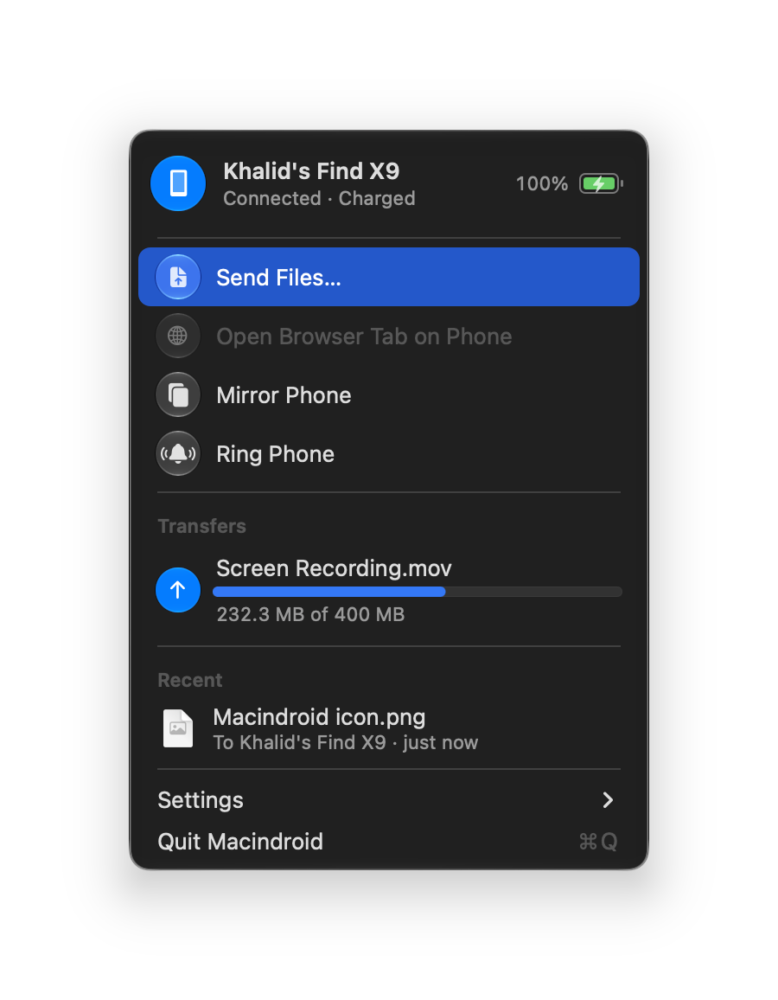
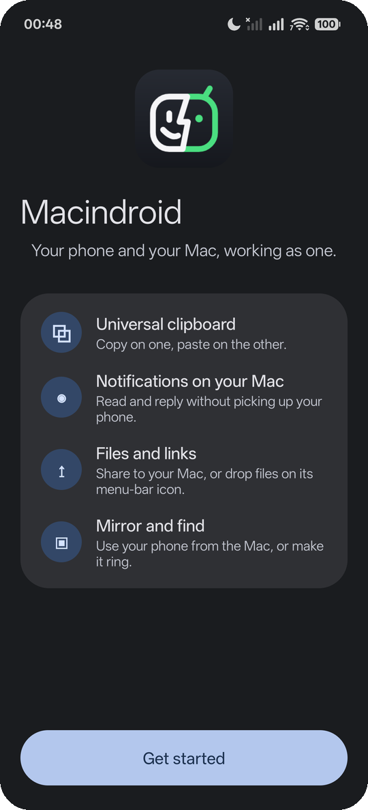
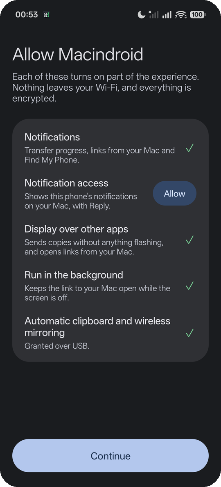

<p align="center">
  
</p>

<h1 align="center">Macindroid</h1>

<p align="center">
  <b>Your Android phone and your Mac, working as one.</b><br>
  Clipboard, notifications, files, photos, screen mirroring and Find My Phone, over your own Wi‑Fi.<br>
  No account, no cloud, no internet. Everything is end‑to‑end encrypted.
</p>

<p align="center">
  <a href="https://github.com/iamkhalid2/macindroid/releases/latest"><b>Download</b></a>
  &nbsp;·&nbsp; macOS 14 or later &nbsp;·&nbsp; Android 14 or later
</p>

<p align="center">
  
</p>

## What it does

| | |
|---|---|
| **Universal clipboard** | Copy on one, paste on the other: text and images, both ways, in about a quarter of a second. Passwords copied from a password manager are never sent. |
| **One‑time codes** | A sign‑in or verification code that reaches your phone, by text message or in an app's notification, is on the Mac's clipboard within about a second, ready to paste: *Code 482913 from Google copied*. Clipboard managers don't keep it, and it's cleared after two minutes. |
| **Notifications on your Mac** | Your phone's notifications appear on the Mac while you aren't using the phone, with Reply and the app's own buttons. Clear one on the Mac and it clears on the phone; click one and it opens on the phone. |
| **Files and links** | Drop files on the menu‑bar icon, or Share → Macindroid on the phone. Files are checksummed and land in Downloads. Send the browser tab you're looking at to the phone in one click. |
| **Photos and screenshots** | Take a photo or a screenshot on the phone and a preview drops down from the menu‑bar icon: copy it, save it to Downloads or drag it anywhere, at full resolution. |
| **Mirror your phone** | Use your phone in a window on the Mac, over USB or Wi‑Fi, through [scrcpy](https://github.com/Genymobile/scrcpy). |
| **Find your phone** | Ring Phone plays an alarm at full volume, even on silent or Do Not Disturb, until you unlock it or press Stop. |
| **At a glance** | The menu shows your phone's battery and connection. The menu‑bar icon shows a progress ring while files move and a ringing bell while the phone rings. |

## Set up

You need a Mac with macOS 14 or later, an Android phone with Android 14 or later on the same Wi‑Fi, and a USB
cable for a one‑time step.

### 1. On the Mac

1. From the [latest release](https://github.com/iamkhalid2/macindroid/releases/latest), download
   `Macindroid-1.0.0.zip`, `Macindroid-1.0.0.apk` and `setup-phone.sh` into your Downloads folder.
2. Open the zip and drag **Macindroid** into **Applications**, then open it.
3. Macindroid isn't notarized by Apple yet, so macOS stops it the first time. Open **System Settings → Privacy &
   Security**, scroll down and click **Open Anyway** next to Macindroid. (Or in Terminal:
   `xattr -dr com.apple.quarantine /Applications/Macindroid.app`.)
4. Click **Allow** when macOS asks to let Macindroid find devices on your local network, and allow
   notifications. Macindroid adds itself to your login items so it's there after a restart.

Its icon, a face that's half Mac and half Android, appears in the menu bar, and a window waits for your phone.

### 2. On the phone

Macindroid needs a few permissions that only a computer can grant over USB: one lets it notice when you copy
something while it's in the background, one lets it switch on wireless debugging just while you mirror, and one
lets it read one‑time codes in notifications, which Android 15 and later hide from apps that read notifications.

1. Install the Android tools on the Mac (with [Homebrew](https://brew.sh)), plus scrcpy for mirroring:
   ```bash
   brew install --cask android-platform-tools && brew install scrcpy
   ```
2. On the phone, turn on **USB debugging**: Settings → About phone → tap **Build number** seven times, then
   Developer options (under Settings → System on most phones) → **USB debugging**.
3. Connect the phone with a cable and run:
   ```bash
   bash ~/Downloads/setup-phone.sh
   ```
   Tap **Allow** on the phone when it asks to trust this computer. The script installs Macindroid, grants those
   permissions and opens the app. You can unplug the phone afterwards.

<p align="center">
  
  &nbsp;
  
  &nbsp;
  
</p>

### 3. Pair

1. On the phone, tap **Get started** and pick your Mac.
2. The Mac and the phone each show a six‑digit code. Check they match, then click **Pair** on the Mac.
3. On the phone, allow what Macindroid asks for: notification access, photos, display over other apps and
   running in the background. Each one says what it's for.
4. Android then asks whether Macindroid may **access all device logs**. Tap **Allow**: that's what lets copies on
   the phone reach the Mac on their own.

That's it. The app leaves the phone's app drawer when setup is done; it lives in the notification shade and in
Quick Settings instead (add the Macindroid tile: tap it to send the clipboard, long‑press it for settings).

<details>
<summary><b>No cable?</b></summary>

Copy `Macindroid-1.0.0.apk` to the phone and open it to install it (Android asks you to allow installing apps
from that source), then pair as above. Everything works except two
things: a copy on the phone reaches the Mac only when you send it (from the Quick Settings tile or by sharing it
to Macindroid), and mirroring over Wi‑Fi needs you to switch on Wireless debugging yourself. You can run
`setup-phone.sh` later to get both.
</details>

## Everyday use

- **Copy and paste** as usual, on either device.
- **Send files** by dropping them on the menu‑bar icon, choosing **Send Files…**, or **Open With → Macindroid** in
  Finder. On the phone, use **Share → Macindroid**. Files arrive in `Downloads` on the Mac and in
  `Download/Macindroid` on the phone.
- **Photos and screenshots** you take on the phone pop up under the menu‑bar icon for a few seconds (longer while
  the pointer is on them). **Copy** puts the full‑size picture on the clipboard, **Save** puts it in Downloads, and
  you can drag it into any app or click it to open it in Preview. Turn it off in Settings → Show New Photos from
  Phone.
- **Send a link** from the phone with Share → Macindroid; it opens in your Mac's browser. From the Mac, choose
  **Open Safari Tab on Phone** (or Chrome, Edge, Brave, Arc, Vivaldi) while the browser is in front.
- **Paste a code**: ask a website for a sign‑in code, and when it arrives on the phone, press ⌘V on the Mac. A
  quiet notice shows which code was copied; click it to copy the code again. Turn this off with **Settings → Copy
  Codes from Phone**.
- **Reply** to a message straight from the notification on the Mac.
- **Mirror Phone** opens your phone in a window. Clicking a phone notification on the Mac also opens it there.
- **Shortcuts**: `macindroid://ring`, `macindroid://stop-ring`, `macindroid://mirror` and `macindroid://menu`
  work from Shortcuts, Spotlight, Raycast or `open`. There's deliberately no link for sending files, since any web
  page can open a link.

## Privacy and security

- **Nothing leaves your network.** The Mac listens on port 47800 and announces itself on your Wi‑Fi with Bonjour
  (`_macindroid._tcp`); the phone connects to it directly. There's no account, server or analytics.
- **Pairing you can check.** The two devices agree a key with X25519. Both screens show a six‑digit code derived
  from that key, so a device in the middle would show a different code. Everything after that is encrypted and
  authenticated with AES‑256‑GCM, using a key derived with HKDF‑SHA256.
- **Secrets stay put.** Copies a password manager marks as concealed on the Mac
  ([nspasteboard.org](http://nspasteboard.org) types, used by 1Password, Bitwarden and others) or as sensitive on
  Android are never sent. Notifications an app marks as secret aren't
  forwarded, and while you're using the phone nothing is, except one‑time codes.
- **One‑time codes, handled like passwords.** Android 15 and later replace codes in notifications with
  *Sensitive notification content hidden* for apps that read notifications. `setup-phone.sh` exempts Macindroid
  from that with one app op (`RECEIVE_SENSITIVE_NOTIFICATIONS`), which you can undo with
  `adb shell appops set xyz.iamkhalid.macindroid RECEIVE_SENSITIVE_NOTIFICATIONS default`. The phone looks for a
  4–8 character code next to a word such as *code*, *OTP*, *verification* or *PIN* (in about 30 languages) and
  skips amounts, dates, times, phone numbers, card endings, order numbers and promo codes. Only the code, the sender
  and the app's name go to the Mac. There it is marked concealed and transient for clipboard managers, so they don't
  store it and Macindroid doesn't send it back, cleared after two minutes unless you've copied something else, and
  the notice showing it is removed at the same time. Neither app ever writes a code to its log.
- **Small permissions, explained.** `READ_LOGS` lets the phone see the one line Android writes each time an app is
  denied the clipboard. Android 10 and later stop background apps from reading the clipboard, so Macindroid
  watches for that line and then reads the clipboard through an invisible 1×1 window.
  `WRITE_SECURE_SETTINGS` switches wireless debugging on only for the length of a mirroring session.
- **Photos stay on the phone until you want them.** Only new camera photos and screenshots, taken while the
  two are connected, are offered, as a preview about 720 pixels across. The original crosses only when you copy,
  save, drag or open it, and the Mac can ask only for a photo it was offered. Pictures saved from chat apps,
  downloaded or synced from the cloud are left alone.
- **Where things live.** On the Mac: the pairing key in `~/Library/Application Support/Macindroid` (readable only
  by you) and a log in `~/Library/Logs/Macindroid.log`.

## Troubleshooting

<details>
<summary><b>The menu says "Looking for your phone · same Wi‑Fi?"</b></summary>

Check that both are on the same Wi‑Fi network, and not a guest network: guest networks often keep devices from
seeing each other. On the Mac, check System Settings → Privacy & Security → Local Network → Macindroid is on. The
phone reconnects by itself within seconds of the Mac coming back, even with its screen off; once the Mac has been
gone for half an hour it checks only every few minutes, to save battery, and waking the phone reconnects it at once.
</details>

<details>
<summary><b>Copies on the phone don't reach the Mac</b></summary>

Android asks again for log access after the phone restarts or Macindroid updates, and only while Macindroid is
on screen. When that's needed, Macindroid's notification on the phone says *Copies on this phone aren't reaching
your Mac*: tap it, then tap **Allow**. If the setup screen says *One‑time step: plug the phone into your Mac*,
run `setup-phone.sh`.
</details>

<details>
<summary><b>Codes don't reach the Mac's clipboard</b></summary>

Check **Settings → Copy Codes from Phone** is ticked. If the Mac shows the phone's notification as *Sensitive
notification content hidden*, Android is hiding the code from Macindroid: run `setup-phone.sh` again. Android checks
this permission when Macindroid starts reading notifications, which the script's reinstall triggers. With the phone
plugged in, `adb logcat -d -s Macindroid | grep "one-time codes"` says whether codes are visible. A code only counts
as one if a word like *code* or *OTP* is near it, so a message that's only a number isn't copied.
</details>

<details>
<summary><b>Mirror Phone is greyed out</b></summary>

Install scrcpy and the Android tools: `brew install --cask android-platform-tools && brew install scrcpy`.
</details>

<details>
<summary><b>Phone notifications don't appear on the Mac</b></summary>

Check System Settings → Notifications → Macindroid. While a Focus is on, they go quietly to Notification Center.
They're also held back while you're using the phone, which is on purpose.
</details>

<details>
<summary><b>macOS says Macindroid "can't be opened"</b></summary>

See step 3 of [On the Mac](#1-on-the-mac). You can check your download against `SHA256SUMS` from the release:
`cd ~/Downloads && shasum -a 256 -c SHA256SUMS --ignore-missing`.
</details>

## Build from source

No Xcode project, no Gradle and no third‑party code: about 2,500 lines of Swift (AppKit, Network, CryptoKit) and a
Java app built with the plain Android SDK tools.

```bash
git clone https://github.com/iamkhalid2/macindroid.git && cd macindroid
./mac/install.sh      # builds Macindroid.app into ~/Applications and starts it at login (Xcode command line tools)
./setup-phone.sh      # builds the APK and installs it over USB (Android SDK with build-tools, JDK 17 or later)
./release.sh          # builds both and writes the release files, with checksums, to dist/
```

The first Android build creates a signing key in `~/.android/macindroid.keystore` and records its password in
`android/signing.env`, which git ignores. Keep both: an update signed with a different key won't install over the
app.

`android/test.sh` checks the one‑time‑code finder against 117 example messages (codes in about 30 languages, and
messages full of numbers that aren't codes) using plain Java, no phone needed.

To test the Mac app without a phone, `cd mac && uv run --with cryptography python3 test_client.py` plays the
phone's part against the running app: ping, a 3 MB file arriving byte‑identical, a corrupted file discarded with
nothing left behind, and a wrong key refused.

## Resource use

Measured with a MacBook Air and an Oppo Find X9, connected and idle:

| | CPU | Wake‑ups | Memory |
|---|---|---|---|
| Mac app | 0.0 % (macOS energy impact 0.0–0.1) | about 1 a second | 35 MB |
| Phone app | 0.4 % of one core, screen on | a ping every 25 s | 69 MB |

## Uninstall

On the Mac, quit Macindroid from its menu, move it to the Trash, and remove its files:

```bash
rm -rf "$HOME/Library/Application Support/Macindroid" ~/Library/Logs/Macindroid.log
```

If you installed with `mac/install.sh`, also run
`launchctl bootout gui/$(id -u)/xyz.iamkhalid.macindroid; rm ~/Library/LaunchAgents/xyz.iamkhalid.macindroid.plist`.

On the phone, go to Settings → Apps → Macindroid → Uninstall, or run `adb uninstall xyz.iamkhalid.macindroid`.

## License

[MIT](LICENSE). scrcpy, which Mirror Phone uses, is a separate project under the Apache License 2.0.
